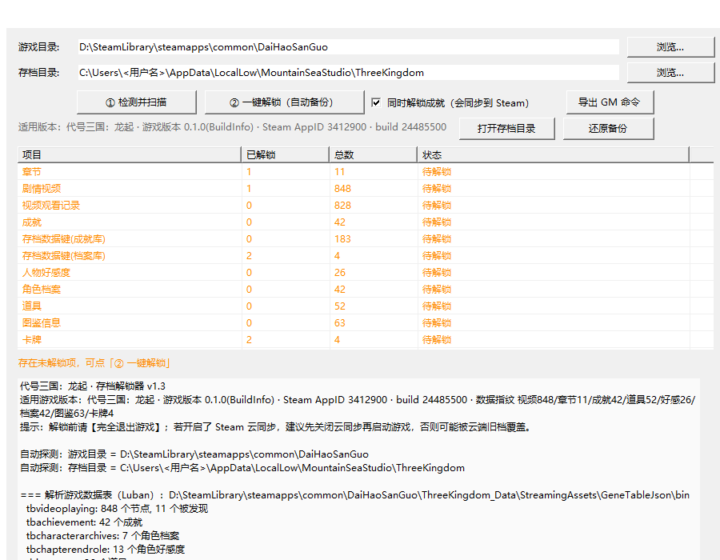
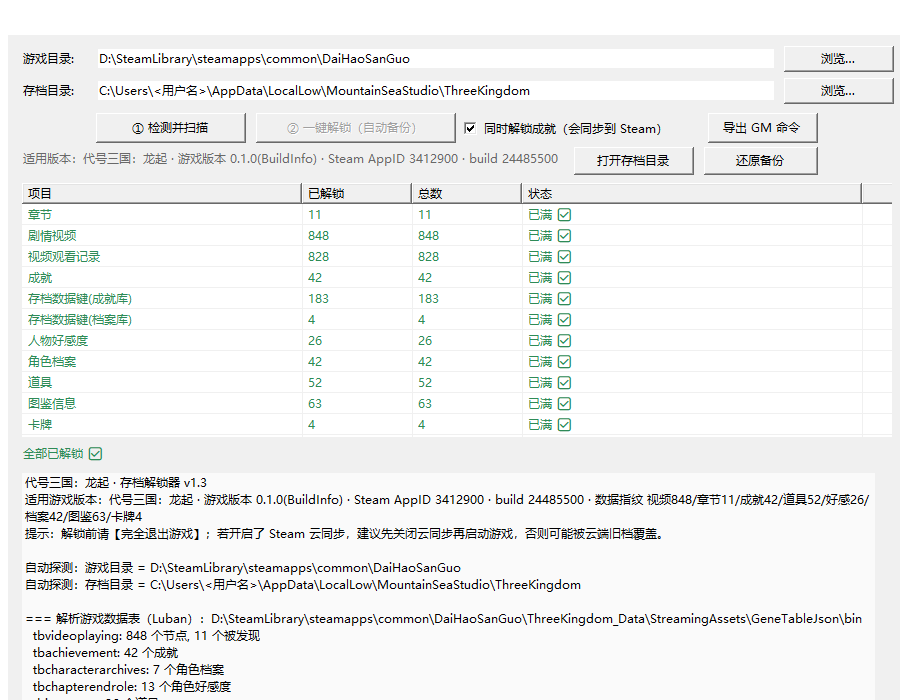

# 代号三国：龙起 · 存档解锁器

一键解锁《代号三国：龙起》的游戏进度：**章节 · 剧情视频 · 图鉴（道具 / 信息）· 人物档案 ·
人物好感度 · 道具 · 卡牌 · 视频回想库**，以及（可选）**成就**。

## 界面预览

| 检测并扫描 | 解锁后 |
|:---:|:---:|
|  |  |

---

## 适用版本

| 项 | 值 |
|---|---|
| 游戏 | 代号三国：龙起 |
| 游戏版本 | 0.1.0 |
| Steam AppID | 3412900 |
| Steam build | 24485500 |
| 数据指纹 | 视频 848 / 章节 11 / 成就 42 / 道具 52 / 好感 26 / 档案 42 / 图鉴 63 / 卡牌 4 |

> 工具启动时会自动检测并打印实测「数据指纹」。若与上表不一致，说明游戏更新过，
> 程序会给出提示（解锁项会按新版本自动跟随，但请先备份、再确认结果）。

## 下载

到本仓库的 **[Releases](../../releases)** 页面下载 `DaiHaoSanGuo_Unlocker.exe`。

- 单文件，免安装，**不需要装 .NET**
- 图标与游戏一致，方便辨认

## 使用方法

1. **完全退出游戏**。
2. （建议）关闭本游戏的 **Steam 云同步**：
   Steam → 右键《代号三国：龙起》→ 属性 → 通用 → 取消勾选「Steam 云」。
   *不关的话，启动时可能被云端的旧存档覆盖，导致解锁看不到效果。*
3. 双击运行 `DaiHaoSanGuo_Unlocker.exe`。
4. 确认界面上两个路径（程序会自动探测）：
   - **游戏目录**：Steam 库里 `steamapps\common\DaiHaoSanGuo`
   - **存档目录**：默认 `%USERPROFILE%\AppData\LocalLow\MountainSeaStudio\ThreeKingdom`
   - 探测不到就点「浏览…」手动选择。
5. 点 **「① 检测并扫描」**，查看每类「已解锁 / 总数」。
6. 点 **「② 一键解锁（自动备份）」**，程序会先自动备份存档，再写入，并回读校验。
7. **完全退出并重启游戏**，进游戏查看效果。

## 成就说明（可选）

界面上有一个勾选框：**「同时解锁成就（会同步到 Steam）」**

- **勾选**：游戏启动时会把本地成就提交为 **Steam 成就**。
- **不勾选**：完全不改动成就，Steam 侧和游戏内的成就页都保持原样。

按自己的需要选择即可。

## 备份与还原

- 每次解锁前都会**自动整目录备份**到存档目录同级：`ThreeKingdom_backup_时间戳\`。
- 想还原：点界面上的 **「还原备份」**，选一个备份目录即可（还原前也会再自动备份一次）。

## 注意事项

- 解锁前**必须完全退出游戏**。
- 本工具修改的是**你自己电脑上的单机存档**，请自行评估并承担使用风险，建议每次都保留备份。
- 仅供学习交流使用。
